> ステータス：**デモを 50 回に増やして学習し直したモデルで、初めて「つかんでトレイに置く」に成功**（成功率の測定はこれから）

ロボットアームに「人がやって見せた動き」を真似させる、模倣学習（Imitation Learning）を一通り試しました。使ったのは Hugging Face のオープンソースのロボット学習ライブラリ **LeRobot** と、オープンソースのアーム **SO-101** の Hiwonder 版 **SO-ARM101** です。

やったことの流れは次のとおりです。

1. リーダーアームを手で動かしてフォロワーアームを操縦する（テレオペ）
2. カメラを付けて、ブロックをトレイに運ぶデモを 30 回収録する
3. そのデータで **ACT**（Action Chunking with Transformers）を学習する
4. 学習したモデルだけでフォロワーを動かす（評価：30 回版では失敗、50 回版で初成功）

途中でグリッパーのサーボの過負荷、USB の切断、Colab の依存関係エラーなどにひととおりハマったので、その切り分けの過程も含めて残しておきます。

---

## 1. 前提知識

### 1-1. 模倣学習とは

模倣学習は、**人のお手本（デモンストレーション）から、ロボットの動かし方を学ぶ手法**です。強化学習のように報酬を設計して試行錯誤させるのではなく、「この状況ではこう動かした」という記録を大量に集めて、それを真似るように学習させます。

一番素朴な形は **Behavior Cloning（行動クローニング）** と呼ばれ、中身はただの教師あり学習です。

- **入力（観測）**：カメラ画像と、ロボットの今の関節角度
- **出力（行動）**：次にロボットに送る関節角度の指令値
- **正解データ**：人がテレオペしたときの「観測 → 指令値」の組

画像分類で「この画像は猫」と学習させるのと同じように、「この画像とこの姿勢のときは、関節をこう動かす」と学習させるイメージです。

素朴な行動クローニングには、よく知られた弱点が2つあります。

| 弱点 | 内容 |
|---|---|
| **誤差の累積（covariate shift）** | 1ステップごとの小さなズレが積み重なり、お手本では一度も見なかった状況に迷い込みます。その先では、どう動けばいいかわかりません |
| **お手本のばらつき（マルチモーダル性）** | 人は同じタスクでも毎回少しずつ違う動きをします。その平均をとると、どのお手本とも違う中途半端な動きになります（「右から回るか左から回るか」を平均すると正面衝突、など） |

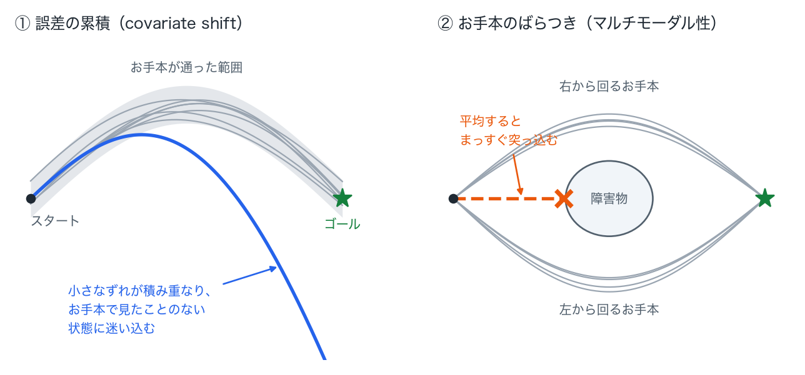

今回使う **ACT** は、この2つにそれぞれ手当てがされたモデルです（後述）。

### 1-2. LeRobot とは

[LeRobot](https://github.com/huggingface/lerobot) は、Hugging Face が開発している実世界ロボット向けの PyTorch ライブラリです。模倣学習を一周するのに必要な道具が一式そろっています。

- **ハードウェアのドライバ**：SO-100/SO-101、LeKiwi などのアームのモーター制御、カメラ
- **データ収録**：テレオペしながら観測と行動を記録して、`LeRobotDataset` という共通形式で保存
- **学習済み・学習可能な方策（policy）**：ACT、Diffusion Policy、π0、SmolVLA など
- **CLI**：`lerobot-teleoperate` / `lerobot-record` / `lerobot-train` などのコマンドで、各ステップを実行

`LeRobotDataset`（今回は v3.0 形式）は、関節データを **Parquet**、カメラ映像を **MP4（AV1 で圧縮）**、メタ情報を JSON で持つ構成です。Hugging Face Hub にそのまま上げて共有できます。

### 1-3. SO-101 と Hiwonder SO-ARM101

**SO-101** は、TheRobotStudio と Hugging Face が公開している低価格の 6 自由度アームです（前身は SO-100）。部品は 3D プリントで作れて、設計も全部オープンソースです。最大の特徴は、**同じ形のアームを2本使う「リーダー・フォロワー」構成**になっていることです。

- **リーダー**：人が手で動かす側。モーターのトルクは切ってあり、各関節の角度をセンサーとして読むだけです
- **フォロワー**：リーダーの角度をそのまま目標値として受け取って、モーターで追従する側。こちらが実際に作業します

同じ形のアームなので、関節角度を1対1でそのままコピーすればいいだけです。逆運動学などは要りません。この手軽さが SO-101 が広まった理由のひとつです。

今回使った **Hiwonder SO-ARM101** は、SO-101 を Hiwonder 社が製品化したものです。主な違いは次のとおりです。

- サーボが Hiwonder の **HX-30HM**（30kg・cm、磁気エンコーダ式）
- 手首カメラ（今回は途中で外しました）
- LeRobot を Hiwonder のサーボに対応させたフォーク：[Hiwonder-official/hiwonder-SoArm-101](https://github.com/Hiwonder-official/hiwonder-SoArm-101)（LeRobot v0.5.1 ベース）

関節は、肩の回転（`shoulder_pan`）、肩の上下（`shoulder_lift`）、ひじ（`elbow_flex`）、手首の曲げ（`wrist_flex`）、手首の回転（`wrist_roll`）、グリッパー（`gripper`）の 6 つで、サーボの ID は 1〜6 です。

### 1-4. 使った環境

| 項目 | 内容 |
|---|---|
| アーム | Hiwonder SO-ARM101（リーダー 1 + フォロワー 1） |
| PC | MacBook Pro（Apple M1 Max / 32GB） |
| 俯瞰カメラ | iPhone（macOS の Continuity カメラで USB カメラとして使用） |
| ライブラリ | hiwonder-SoArm-101（LeRobot v0.5.1 ベース）、Python 3.13 |
| 学習 | Google Colab Pro（NVIDIA A100 40GB） |

---

## 2. 全体の流れ

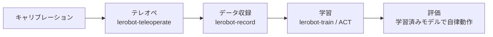

---

## 3. テレオペ：リーダーでフォロワーを動かす

### 3-1. コマンド

Mac では、アームは USB シリアル（`/dev/tty.usbmodem...`）として見えます。2 本つなぐとポートが 2 つ出るので、どちらがリーダーかを `lerobot-find-port` で特定しておきます。

```bash
lerobot-teleoperate \
  --robot.type=so101_follower --robot.port=/dev/tty.usbmodemXXXX1 --robot.id=my_follower \
  --teleop.type=so101_leader  --teleop.port=/dev/tty.usbmodemXXXX2 --teleop.id=my_leader \
  --display_data=true
```

`--display_data=true` を付けると、関節の値とカメラ映像を [Rerun](https://rerun.io/) のビューアでリアルタイムに確認できます。

### 3-2. 中で起きていること

テレオペのループは、既定で **60Hz** で次の処理を繰り返しています。

1. リーダーの全サーボから現在位置をまとめて読む（`sync_read("Present_Position")`）
2. キャリブレーションの値を使って、生のエンコーダ値（0〜4095）を正規化した値に変換する
3. その値をフォロワーの目標位置として書き込む（`Goal_Position`）

正規化に使うのが、`~/.cache/huggingface/lerobot/calibration/` に保存されるキャリブレーションファイルです。関節ごとに次の値を持っています。

```json
"gripper": { "id": 6, "drive_mode": 0, "homing_offset": -964, "range_min": 1083, "range_max": 2837 }
```

- `homing_offset`：可動範囲の中央がエンコーダの中央（2047 付近）に来るようにずらす量。サーボ側にも書き込まれます
- `range_min` / `range_max`：その関節が実際に動ける範囲（生の値）

グリッパーは「`range_min` を 0、`range_max` を 100」とする割合で扱われます。リーダーで 17% まで閉じれば、フォロワーにも自分の範囲の 17% の位置が指令されます。リーダーとフォロワーで生の値の範囲が違っても、割合で対応がとれる仕組みです。**逆に言うと、キャリブレーションが実機とずれていると、物理的に届かない位置が指令されることになります。** これが後のハマりどころにつながりました。

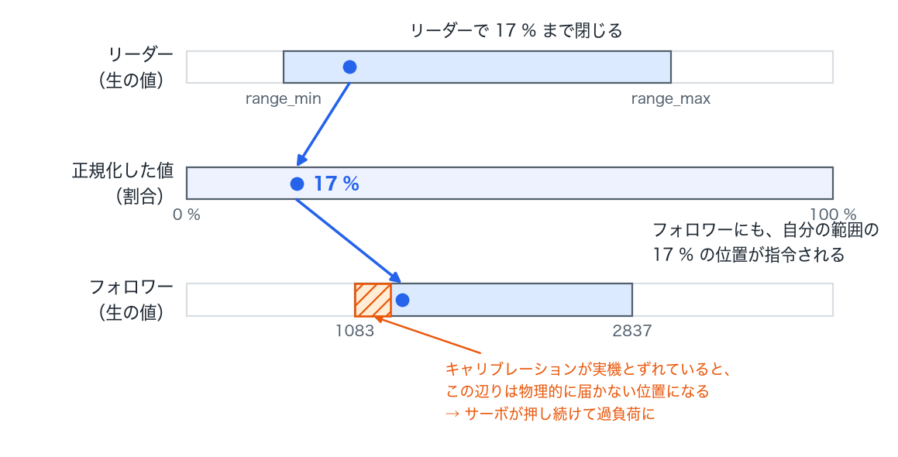

### 3-3. ハマりどころ①：起動時の確認プロンプト

起動のたびに、フォロワー側で次の確認が出ます。

```
Press ENTER to use provided calibration file associated with the id my_follower,
or type 'c' and press ENTER to run calibration:
```

サーボに書き込まれている値と、ファイルの値が一致しないときに出ます。Enter を押せば、ファイルの値がサーボに書き戻されます。対話できないバックグラウンドで起動すると、`input()` が `EOFError` で落ちるので、`printf '\n' | lerobot-teleoperate ...` のように標準入力から Enter を送って回避しました。

---

## 4. カメラの準備

### 4-1. カメラ番号の特定

`lerobot-find-cameras opencv` を実行すると、OpenCV から見えるカメラを順に開いて、1 枚ずつ画像を保存してくれます（`outputs/captured_images/`）。Mac では、内蔵カメラ、Web 会議用のカメラ、Continuity カメラ（iPhone）などが全部並ぶので、保存された画像を見てどれが何かを判断します。番号は接続状況で変わることがあるので、毎回確認するのが安全です。

### 4-2. 手首カメラ

付属の手首カメラは 640×480 で、30fps を指定しても実測は **約 23fps** でした。部屋が暗く、自動露出で露光時間が伸びていたのが原因とみられます。

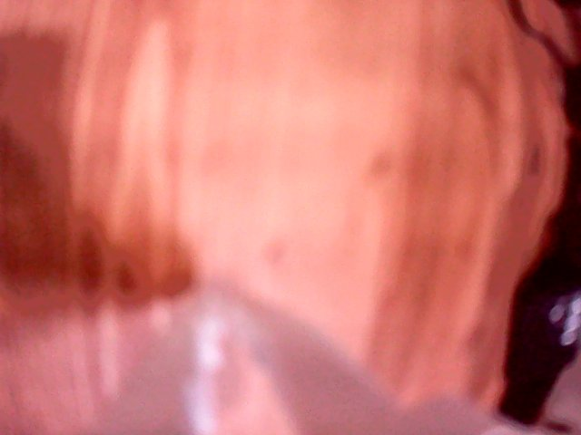

付ける向きの都合で映像が 90° 傾いていたので、LeRobot のカメラ設定の `rotation` で回転させました。

```bash
--robot.cameras="{ wrist: {type: opencv, index_or_path: 0, width: 480, height: 640, fps: 30, rotation: -90} }"
```

ここで1点注意があります。**`width` / `height` には「回転した後」のサイズを書きます**。90° 回すと縦長になるので、`width: 480, height: 640` です。`rotation` の値は `90` が時計回り、`-90` が反時計回り、`180` が上下反転です（中では `cv2.ROTATE_90_CLOCKWISE` などに変換されます）。

最終的に、手首カメラはこのあと説明するグリッパーのトラブルの原因になったので、今回は外しました。

### 4-3. 俯瞰カメラ（iPhone）

2 台目のカメラとして、iPhone を俯瞰カメラにしました。macOS の Continuity カメラを使うと、iPhone が普通の USB カメラとして OpenCV から見えます。640×480・30fps で、フレームレートも安定していました。

最初に置いた位置では、画面の大部分がモニターやマイクアームで、アームと作業場所はほとんど写っていませんでした。

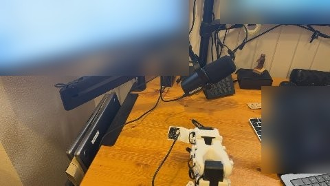

模倣学習のモデルは、この画像から「ブロックがどこにあるか」「アームが今どこにいるか」を読み取ります。なので、**作業範囲・対象物・置き場所・アーム全体が画面の中央に収まるように**直しました。収録を始めた後は、学習と評価が終わるまでカメラの位置を変えないことが大事です。

> Continuity カメラは、iPhone のロックや通知で映像が一瞬止まることがあります。LeRobot は最新フレームが **500ms** より古いと `TimeoutError` を出して止まるので、iPhone は電源につないで、自動ロックをオフにしておきます。
>
> また、Continuity カメラは開いた直後の数フレームだけ 16:9（640×360）で届くことがありました。LeRobot は毎フレームのサイズを設定値（640×480）と照合していて、合わないと読み込みに失敗します。起動直前に一度カメラを開いて閉じておくと、安定して 4:3 で届きました。

### 4-4. なぜ外カメラ（俯瞰カメラ）が重要なのか

模倣学習のモデルにとって、カメラは**世界を知るほぼ唯一の手段**です。モデルに入る情報は「カメラの画像」と「自分の関節角度」の 2 つだけです。関節角度からわかるのは自分の腕の形だけなので、**ブロックがどこにあるか、トレイがどこにあるかは、画像からしか知りようがありません**。

俯瞰カメラには、主に 3 つの役割があります。

1. **対象物の位置を知る**：ブロックが毎回違う場所に置かれても、画像の中のブロックの位置から、どこに手を伸ばせばいいかを判断します
2. **アームと対象物の位置関係を知る**：アーム全体と対象物が同じ画面に写っているので、「手先がブロックの右にずれている」といった関係がわかります
3. **作業の進み具合を知る**：ブロックをもうつかんだか、トレイに置いたかを画像から判断して、次の動作に移ります

ここで大事なのは、**モデルは「画面のどこに写っているか」で位置を覚えている**ということです。モデルが学習するのは、「画面の左上にブロックが写っているときは、肩をこう回す」という**画像上の位置と関節角度の対応**です。机の上の実際の座標を理解しているわけではありません。

そのため、カメラが少し動くだけで、同じ場所にあるブロックが画面上では別の位置に写ります。モデルは「ブロックが別の場所にある」と受け取って、ずれた場所に手を伸ばしてしまいます（8 章で実際にこれが起きました）。

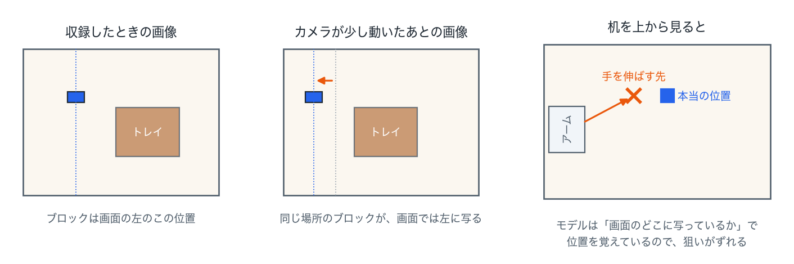

| | 俯瞰カメラ | 手首カメラ |
|---|---|---|
| 見えるもの | 作業範囲全体（対象物・置き場所・アーム） | 手先のすぐ近く |
| 得意なこと | 「どこに向かうか」の大まかな判断 | 「どうつかむか」の細かい位置合わせ |
| カメラの位置ずれ | **弱い**（位置ずれがそのまま狙いのずれになる） | 強い（手と一緒に動くので、手先との位置関係は変わらない） |

ALOHA などの研究では、**俯瞰カメラと手首カメラを組み合わせる**のが定番です。俯瞰カメラで大まかに近づいて、手首カメラで最後の位置合わせをする、という役割分担です。

---

## 5. ハマりどころ②：グリッパーの過負荷と通信断

ここがいちばん時間を取られたところです。

### 5-1. 症状

テレオペを始めて 1〜2 分で、毎回ループが落ちました。

```
ConnectionError: Failed to sync read 'Present_Position' on ids=[1, 2, 3, 4, 5, 6] after 1 tries.
[TxRxResult] There is no status packet!
...
RuntimeError: Failed to write 'Torque_Enable' on id_=6 with '0' after 6 tries. [ServoStatus] Overload error!
```

- **1つ目のエラー**：サーボから応答が返ってこない
- **2つ目のエラー**：終了処理でトルクを切ろうとしたら、グリッパー（ID 6）が「過負荷（Overload）」を返した

一度この状態になると、フォロワーの電源を入れ直すまで、グリッパーのサーボ（ID 6）がバスから見えなくなりました（`Missing motor IDs: 6`）。サーボの過負荷保護がかかったままになるためです。

### 5-2. 切り分け

2 回とも、落ちる直前のグリッパーの指令値が **17.1%**（生の値で約 1190）でした。一方で、フォロワーのグリッパーの実際の位置を読むと **2033〜2038 付近で止まって** いました。

そこで、**トルクを切った状態で、グリッパーを手で動かしながら生の値を読む**スクリプトを書いて確かめました。

```python
r = SOFollower(SOFollowerRobotConfig(port=PORT, id="my_follower"))
r.bus.connect()
r.bus.disable_torque("gripper")
print(r.bus.read("Torque_Enable", "gripper", normalize=False))   # → 0（オフ）
while True:
    print(r.bus.read("Present_Position", "gripper", normalize=False))
```

結果は次のとおりです。

- トルクは確かにオフ（`Torque_Enable = 0`）なのに、手で押しても**グリッパーが物理的に動かない**
- 値は 2037 から一切変わらない

トルクが切れているのに手で動かないので、原因はソフトではなく**機械的なもの**です。調べると、手首カメラのマグネットマウントが爪の可動域に干渉していました。マウントを外すと、グリッパーは手で軽く開け閉めできるようになりました。

つまり、起きていたのは次のことです。

1. キャリブレーションのファイル上は、グリッパーは 825 まで閉じられることになっていた
2. 実際には、マウントに当たって 2033 付近までしか閉じられなかった
3. リーダーで握り込むと 1190 が指令されるが、届かないので、サーボが全力で押し続ける
4. 過負荷保護がかかってサーボが応答しなくなり、テレオペのループが落ちる

なお、Hiwonder 版のフォロワーは、接続時にグリッパーだけ保護を強めに設定しています（`so_follower.py` の `configure()`）。

```python
if motor == "gripper":
    self.bus.write("Max_Torque_Limit", motor, 500)    # 最大トルクを 50% に
    self.bus.write("Protection_Current", motor, 250)  # 保護電流を 50% に
    self.bus.write("Overload_Torque", motor, 25)      # 過負荷時は 25% トルクに
```

物をつかんだまま握り続けるのはグリッパーのよくある使い方なので、こうして焼損を防いでいます。今回はその保護が正しく働いた、ということでもあります。

### 5-3. 通信断も切り分ける

途中で、フォロワーの USB 接続そのものが Mac から消えることも 2 回ありました。電源不足と配線不良のどちらかを疑って、次の 2 つで切り分けました。

**電圧**：全サーボの `Present_Voltage` を読むと、123〜125（0.1V 単位なので **12.3〜12.5V**）でした。12V 系のアダプタで正しく給電されていて、電源の取り違えではありません。

**関節を 1 つずつ動かしながらの通信テスト**：トルクを切った状態で、関節を 1 つずつ大きく動かしながら、全サーボの位置を 50Hz で読み続けました。

| 動かした関節 | 読み取り成功 | エラー |
|---|---|---|
| 肩の回転 | 331 | 0 |
| 肩の上下 | 333 | 0 |
| ひじ | 332 | 0 |
| 手首の曲げ | 327 | 0 |
| 手首の回転 | 330 | 0 |
| グリッパー | 331 | 0 |

ケーブルを挿し直したあとは、どの関節を動かしてもエラーは 0 でした。動かしたときだけ通信が切れていたので、サーボ間のケーブルの接触不良だったと考えています。

### 5-4. キャリブレーションのやり直し

マウントを外した状態で、フォロワーのキャリブレーションをやり直しました。LeRobot のキャリブレーションは、次の 2 段階です。

1. **中央の記録**：全関節を可動範囲の真ん中あたりに置いて、`set_half_turn_homings()` を呼びます。今の位置がエンコーダの中央（2047）に来るような `homing_offset` を計算して、サーボに書き込みます
2. **範囲の記録**：各関節を端から端まで手で動かして、そのあいだの生の値の最小と最大を `range_min` / `range_max` として記録します（手首の回転だけは 1 回転するので 0〜4095 固定）

標準の `lerobot-calibrate` は各段階で Enter の入力を待ちます。今回は会話しながら進めたかったので、Enter の代わりに「合図のファイルができたら次へ進む」小さなスクリプトに置き換えました。記録した範囲が狭すぎる関節があれば保存しない、という安全策も入れています。

| 関節 | range_min | range_max | 幅 |
|---|---|---|---|
| 肩の回転 | 714 | 3205 | 2491 |
| 肩の上下 | 1309 | 3612 | 2303 |
| ひじ | 691 | 2731 | 2040 |
| 手首の曲げ | 202 | 2259 | 2057 |
| グリッパー | 1083 | 2837 | 1754 |

グリッパーの `range_min` が、実際に閉じきれる 1083 になりました。これでリーダーを握り込んでも物理的な限界を越えた指令は出なくなり、過負荷も起きなくなりました。

---

## 6. データ収録

### 6-1. タスク

**透明ケースに入ったブロックをつかんで、茶色のトレイに置く**、という単純な把持・配置タスクにしました。

- ブロックの初期位置は、毎回左右・前後に数 cm ずつずらす（位置が変わっても対応できるようにするため）
- 置き場所（トレイ）は固定

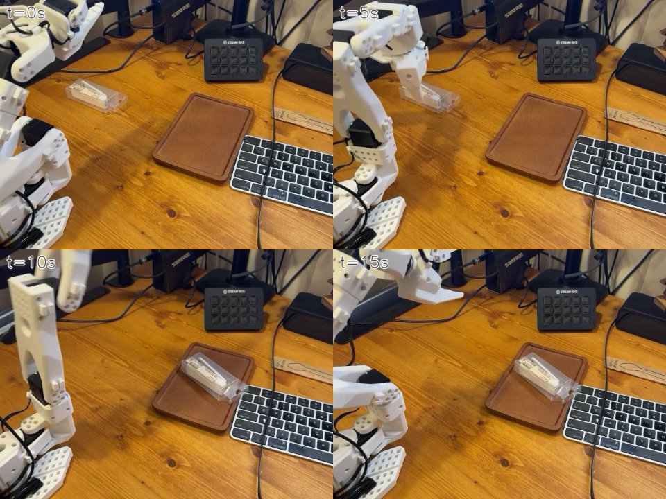

### 6-2. コマンド

```bash
lerobot-record \
  --robot.type=so101_follower --robot.port=/dev/tty.usbmodemXXXX1 --robot.id=my_follower \
  --robot.cameras="{ front: {type: opencv, index_or_path: 4, width: 640, height: 480, fps: 30} }" \
  --teleop.type=so101_leader --teleop.port=/dev/tty.usbmodemXXXX2 --teleop.id=my_leader \
  --dataset.repo_id=local/so101_block_place \
  --dataset.single_task="Pick up the block and place it in the target area" \
  --dataset.num_episodes=30 --dataset.episode_time_s=20 --dataset.reset_time_s=10 \
  --dataset.push_to_hub=false \
  --display_data=true
```

- 1 回は「操作 20 秒 → 次の準備 10 秒」です。区切りごとに Mac が "Recording episode N" "Reset the environment" と読み上げてくれるので、キーボードを触らずに進められます
- 1 フレームごとに、**観測**（`observation.state` = フォロワーの関節位置、`observation.images.front` = カメラ画像）と、**行動**（`action` = リーダーから来た指令値）を 30fps で記録しています
- 模倣学習で学ぶのは、この「観測 → 行動」の対応です

### 6-3. 結果

| 項目 | 値 |
|---|---|
| 録画した回数 | 30 回 |
| 総フレーム数 | 17,960（1 回あたり 597〜600） |
| 所要時間 | 約 18 分 |
| データサイズ | 634MB |

各回の最初の 1〜2 秒だけ、`Record loop is running slower (9〜22 Hz) than the target FPS (30 Hz)` という警告が出ました。前の回の動画を AV1 で書き出す処理と重なるのが原因です。抜けたフレームは 1 回あたり最大 3 フレームだったので、そのまま使いました。`--dataset.streaming_encoding=true` を付けると、収録しながら動画を書き出すので改善するようです。

---

## 7. 学習：ACT

### 7-1. ACT とは：ひとことで言うと

ACT（Action Chunking with Transformers）は、**「カメラ画像と今の姿勢を見て、この先 3 秒ほどの腕の動かし方を、まとめて一気に予測する」ニューラルネットワーク**です。

人がブロックをつかむときも、0.03 秒ごとに「次はどう動かすか」を考え直したりはしません。「あそこにあるから、こう手を伸ばして、つかんで、持ち上げる」と、ひとまとまりの動きを思い浮かべてから動きます。ACT もこれと同じで、**動きを「かたまり（チャンク）」で出す**のが最大の特徴です。

| | 1 ステップずつ予測する素朴な方法 | ACT |
|---|---|---|
| 1 回の予測で出すもの | 次の 1 ステップ（1/30 秒）分の指令 | この先 100 ステップ（約 3.3 秒）分の指令 |
| 動きのなめらかさ | ガタつきやすい | なめらか |
| 誤差の積み重なり | 起きやすい | 起きにくい |
| 途中の状況変化への対応 | 毎ステップ見直すので早い | チャンクの切れ目まで見直さない（`n_action_steps` で調整できる） |

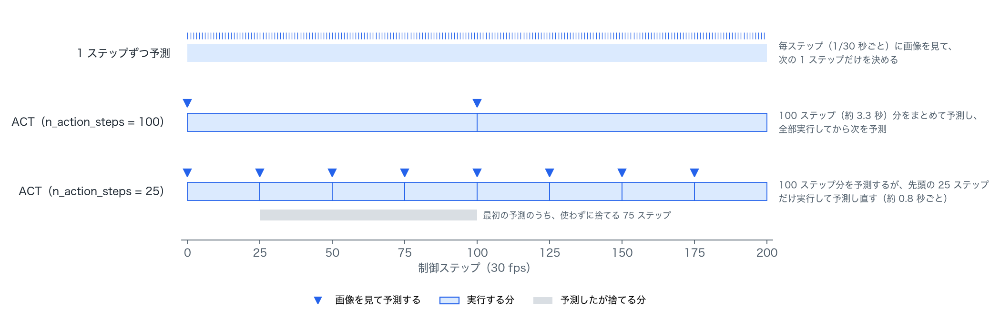

ALOHA の論文で、少ないデモ（タスクあたり 50 回程度）から細かい作業を学習できることが示されました。そこから、LeRobot で最初に試すモデルの定番になっています。学習が比較的速く、手元の GPU でも回せるのも、入門に向いている理由です。

### 7-2. ACT の仕組み（技術的な詳細）

ACT は、低価格の双腕ロボット **ALOHA** の論文（Zhao et al., 2023）で提案されたモデルです。1-1 で挙げた行動クローニングの弱点に、それぞれ次のように手当てしています。

**① Action Chunking：まとめて先まで予測する**
1 ステップ先の行動だけでなく、**k ステップ分の行動をまとめて（チャンクで）予測**します。今回の設定は `chunk_size=100` なので、30fps で約 3.3 秒分です。1 回の予測で長めに動けるので、1 ステップごとの小さなズレが積み重なる機会が減ります。

**② CVAE：お手本のばらつきを潜在変数で吸収する**
学習時は、エンコーダが「お手本の行動列」を 32 次元の潜在変数 z に圧縮して、デコーダは z と観測から行動列を復元するように学習します。z が「今回はこういうスタイルでやった」という差を吸収するので、ばらつく複数のお手本を平均してしまう問題を避けられます。推論時は z = 0（平均的なスタイル）を使います。`kl_weight=10` は、z が無秩序に広がらないようにする正則化の強さです。

**③ 構成**
- 画像を **ResNet18**（ImageNet で事前学習済み）で特徴量に変換
- 画像特徴・関節位置・z を **Transformer**（エンコーダ 4 層 + デコーダ 1 層、`dim_model=512`）に入れて、100 ステップ分の行動を一度に出力
- 入力と出力は、データセットの平均・標準偏差で正規化（`MEAN_STD`）

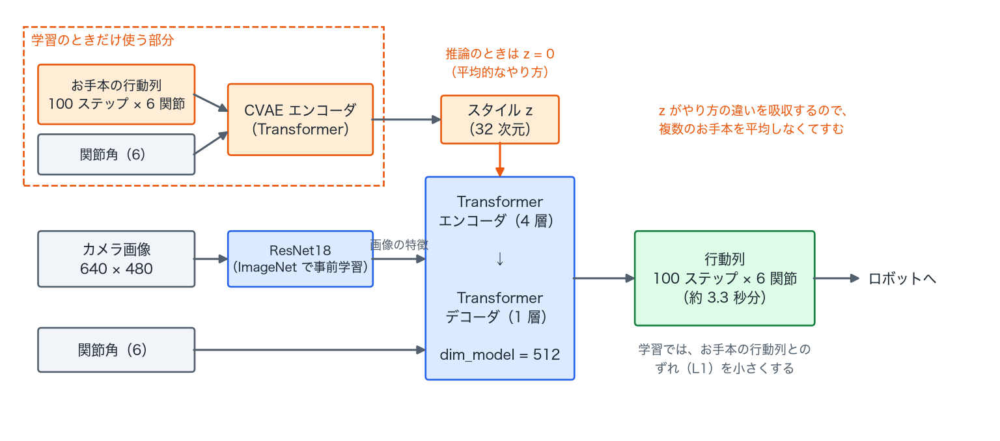

パラメータ数は約 **5,160 万**です。

### 7-3. どこで学習するか

まずは手元の M1 Max（Apple の GPU = MPS）で、300 ステップだけ試しに回しました。

| 環境 | 1 ステップ（バッチ 8） | 3 万ステップの見込み |
|---|---|---|
| M1 Max（MPS） | 0.40〜0.55 秒 | 約 4〜4.5 時間 |
| Colab Pro（A100） | **0.059 秒** | **約 33 分（実測）** |

手元でも学習は正常に進みましたが、時間がかかりすぎるので、Google Colab Pro の A100 で回しました。**7 倍以上速く**なっています。

データセットの受け渡しには Google ドライブを使いました。Mac の Google ドライブ同期フォルダに tar で固めたデータセットを置き、Colab からドライブをマウントして展開する流れです。学習結果（チェックポイント）もドライブに書き出すようにしておけば、終わると自動で Mac 側に同期されます。

```bash
lerobot-train \
  --dataset.repo_id=local/so101_block_place \
  --policy.type=act --policy.device=cuda --policy.push_to_hub=false \
  --output_dir=/content/drive/MyDrive/lerobot/outputs/act_so101_block_place \
  --steps=30000 --batch_size=8 --save_freq=5000 --num_workers=8 \
  --wandb.enable=false
```

### 7-4. ハマりどころ③：Colab で動かない（2 つ）

**(1) `transformers` のバージョン違いで import 時に落ちる**

```
TypeError: non-default argument 'backbone_cfg' follows default argument 'problem_type'
  File ".../lerobot/policies/groot/groot_n1.py", line 176
```

LeRobot は、起動時に `transformers` が入っていれば GR00T（別のモデル）のコードも読み込みます。Colab には新しい `transformers` が最初から入っていて、その中の `PretrainedConfig` と GR00T の設定クラスの組み合わせが dataclass のルールに違反して落ちていました。ACT は `transformers` を使わないので、**手元の環境と同じように `transformers` をアンインストール**して回避しました（`pip uninstall -y transformers`）。

**(2) Mac で作った tar に `._` ファイルが混ざる**

```
ArrowInvalid: Parquet magic bytes not found in footer.
  '.../meta/episodes/chunk-000/._file-000.parquet'
```

macOS の `tar` は、ファイルの拡張属性を `._ファイル名`（AppleDouble 形式）という隠しファイルにしてアーカイブに含めます。Linux で展開するとそれが普通のファイルとして出てきて、LeRobot が `*.parquet` として読もうとして失敗します。対策は次のどちらかです。

```bash
# Mac 側：属性ファイルを含めずに固める
COPYFILE_DISABLE=1 tar -cf so101_block_place.tar so101_block_place
# Linux 側：展開後に消す
find so101_block_place -name '._*' -delete
```

### 7-5. 学習結果

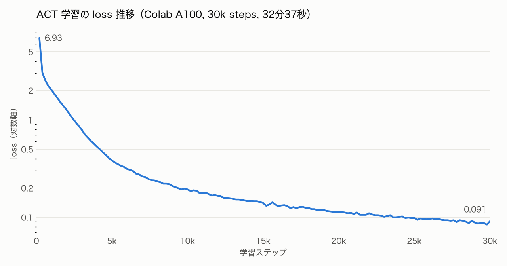

| 項目 | 値 |
|---|---|
| ステップ数 | 30,000（データ全体を約 13 周） |
| 学習時間 | 32 分 37 秒（約 16 ステップ/秒） |
| loss | 6.93（200 ステップ目）→ **0.091**（30,000 ステップ目） |
| チェックポイント | 5,000 ステップごとに 6 個 |

loss は最初の 5,000 ステップで急激に下がり、その後はなだらかに下がり続けています。この loss は「お手本の行動との誤差（L1）+ CVAE の KL 項」で、学習データにどれだけ合っているかの指標です。**実機でタスクを成功できるかどうかは、実際に動かしてみないとわかりません**。ここからは評価です。

---

## 8. 評価

### 8-1. 評価のしかた

評価にも `lerobot-record` を使います。`--teleop` の代わりに `--policy.path` を渡すと、リーダーの代わりに学習したモデルが行動を出します。評価の様子もデータセットとして記録されます（`repo_id` は `eval_` で始める決まりです）。

```bash
lerobot-record \
  --robot.type=so101_follower --robot.port=/dev/tty.usbmodemXXXX1 --robot.id=my_follower \
  --robot.cameras="{ front: {type: opencv, index_or_path: 4, width: 640, height: 480, fps: 30} }" \
  --policy.path=outputs/train/act_so101_block_place/030000/pretrained_model --policy.device=mps \
  --dataset.repo_id=local/eval_so101_block_place \
  --dataset.single_task="Pick up the block and place it in the target area" \
  --dataset.num_episodes=5 --dataset.episode_time_s=30 --dataset.reset_time_s=10 \
  --dataset.push_to_hub=false --display_data=true
```

推論は手元の M1 Max（MPS）で行いました。約 3.3 秒ごと（= `n_action_steps=100` ステップごと）に処理が 12〜15Hz まで落ちる警告が出ます。ACT は 100 ステップ分の行動をまとめて予測するので、その予測を計算する瞬間だけループが待たされるためです。

### 8-2. 1 回目の結果：失敗（カメラの位置がずれていた）

評価の直前に、iPhone が倒れて向きが変わっていたことに気づきました。手で元の位置に戻そうとしましたが、完全には戻せませんでした。収録時の映像（左）と、評価時の映像（中央）、それを重ねたもの（右）がこちらです。

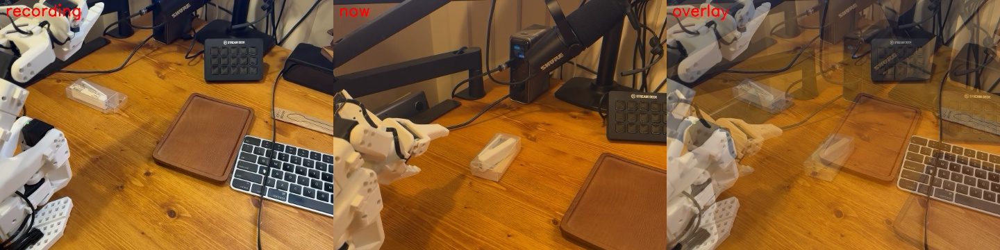

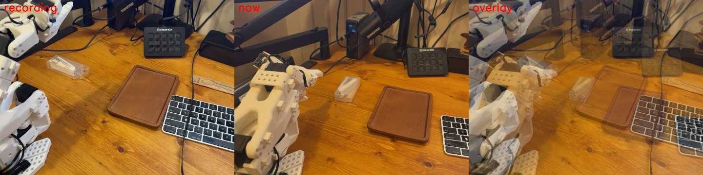

4 回置き直して、物の並びはおおむね合いました。それでも、トレイの位置は画面の 1 割ほどずれていて、見下ろす角度も低いままでした。この状態で評価したところ、次のようになりました。

- アームはブロックに向かわず、**ブロックの奥の机**に向かった
- そのまま机を押しつけるように閉じようとして、ブロックはつかめなかった
- グリッパーが机に当たったまま閉じる指令を受け続けたため、**過負荷保護**が働いた
- さらに、次の回の準備中に iPhone の映像が 0.5 秒途切れて、記録ごと止まった

ACT は、カメラ画像の「どこに何が写っているか」から、ブロックの位置を読み取っています。カメラが動くと、画像の中でブロックが写る位置も変わります。モデルにはそれが「ブロックが別の場所にある」ように見えるので、ずれた場所に手を伸ばしてしまいます。今回は、その典型例でした。

**学び：俯瞰カメラは収録から評価まで「絶対に動かさない」。** スタンドで固定して、置き場所に印を付けておくべきでした。手首カメラを併用すると、手先の近くの見え方はカメラの置き方に左右されにくいので、こうしたずれに強くなると言われています。

> LeRobot の `lerobot-record` は、「準備時間」が終わってから直前の回を保存します。準備時間中にエラーで落ちると、直前の回の記録も失われます。評価を 1 回ずつ（`--dataset.num_episodes=1`）実行して、`--resume=true` で追記していくと、この事故を避けられます。

### 8-3. カメラを合わせ直す：位置合わせツールを作る

手で置き直してスナップショットを見比べるのは、何往復もかかって大変でした。そこで、**iPhone の映像に収録時の輪郭を重ねて、ずれ量と直す方向をリアルタイムに表示する**小さなツールを作りました。

- 収録時のフレームから **Canny** でエッジ（輪郭）を取り出し、今の映像に赤い線で重ねる
- 収録時と今の映像から **ORB** 特徴点を取り、`cv2.estimateAffinePartial2D`（RANSAC つき）で「平行移動 + 回転 + 拡大縮小」を推定する
- 推定した移動量から、`PAN RIGHT`（右に振る）、`TILT DOWN`（下向きにする）、`MOVE BACK`（後ろに引く）などの指示を表示する

アームは収録時と姿勢が違うので、動いているアームの特徴点に推定が引っ張られることがありました。RANSAC で外れ値として除かれるので、背景の物（トレイ・キーボード・ストリームデッキ）の輪郭を見て合わせれば十分でした。

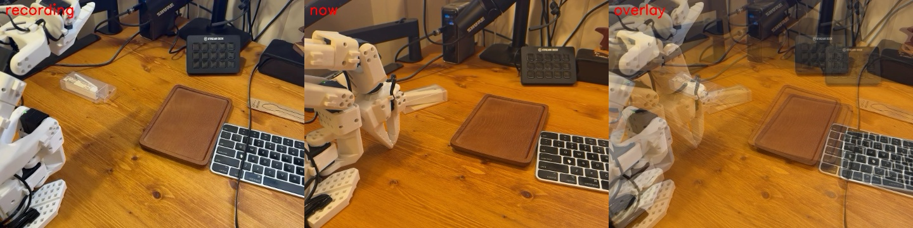

最終的に、トレイの位置の差は画面の 2〜4% まで縮まりました。

### 8-4. 2 回目の結果：動きの流れは再現、でもつかめない

カメラを合わせ直してから、もう一度評価しました（`n_action_steps=100`）。

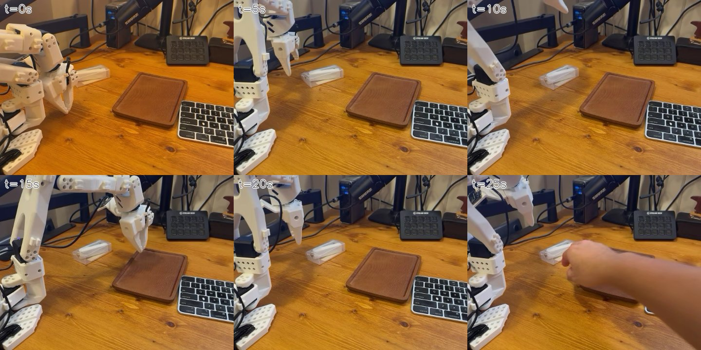

| 時刻 | アームの動き |
|---|---|
| 0 秒 | ブロックの近くから動き始める |
| 5 秒 | 持ち上げる動作をする。ただし、ブロックは机の上に残ったまま |
| 10 秒 | 腕を上げる |
| 15 秒 | **トレイの上まで移動して「置く」動作をする**（手には何も持っていない） |
| 20〜25 秒 | 腕を戻す |

1 回目のように机の奥をつかみにいくことはなくなり、**「近づく → 持ち上げる → 運ぶ → 置く」という動きの流れそのものは再現できました**。ただし、つかむ瞬間の位置がずれていてブロックをつかみ損ね、そのまま空の手で、覚えた運ぶ動作をなぞっていました。

### 8-5. 3 回目：予測を細かく出し直す（`n_action_steps=25`）

ACT は既定で 100 ステップ分（約 3.3 秒）の行動を予測して、それを**全部実行し終わるまで画像を見直しません**。つかむ直前に少しずれていても、途中で直せないわけです。

`n_action_steps` は、予測した 100 ステップのうち何ステップ分を実行したら次の予測をするかを決める値です。学習し直さずに、**評価時のオプションだけで変えられます**。

```bash
lerobot-record ... --policy.n_action_steps=25
```

25 にすると、約 0.8 秒ごとに画像を見て計画し直すことになります（7-1 の図の 3 段目）。

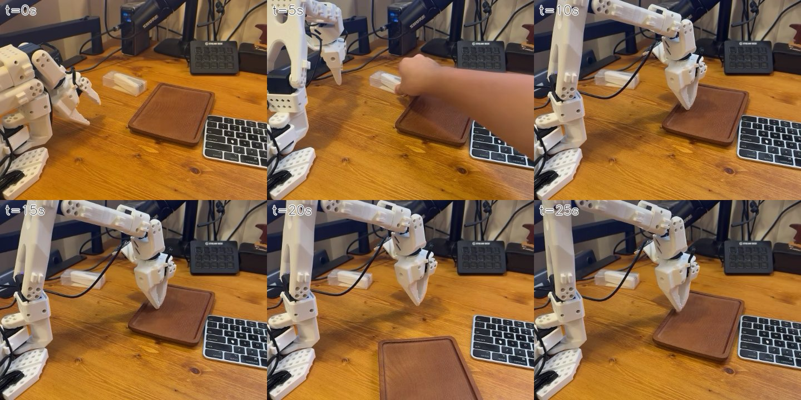

結果は、**今回もブロックはつかめませんでした**。アームはトレイのほうへ向かって、トレイの上で手先を下ろす動作を繰り返し、最後はグリッパーがまた過負荷になりました。途中（5 秒前後）で人の手がブロックに触れて位置が変わってしまったので、条件のそろった比較にはなっていません。

予測の回数が 4 倍になったので、推論で処理が待たされる回数も増えました（速度低下の警告が 35 回）。

### 8-6. ここまでの考察

つかめない原因として、次のことが考えられます。

1. **カメラの見え方が収録時と完全には同じでない**：2〜4% の差でも、つかむ位置の精度には効いてきます
2. **ブロックが透明なケースに入っている**：背景の机が透けて見えて輪郭がはっきりしないので、画像から位置を読み取りにくい対象です
3. **デモが 30 回と少なく、カメラが俯瞰の 1 台だけ**：つかむ瞬間の細かい位置合わせには、手首カメラの情報が効くとされています

次は、**今のカメラ位置を新しい基準として固定**して、**不透明で色のはっきりしたブロック**で 50 回ほど録り直して、学習し直すつもりでした。

### 8-7. デモを 20 回足して、50 回で学習し直す

結局、録り直しはせずに、**今のカメラ位置で 20 回を追加で収録して、合計 50 回で学習し直す**ことにしました。

- **カメラ**：評価のために合わせ直した位置のまま固定して収録しました。最初の 30 回とは 2〜4% ほど見え方が違いますが、2 つの位置のデータが混ざることで、多少のずれに強くなる効果も期待できます
- **ブロック**：最初の 30 回と同じ透明のものを使いました（途中で物を変えると、別のタスクになってしまうため）
- **開始姿勢**：毎回、折りたたんだ休止姿勢から始めました（評価も同じ姿勢から始めます）

LeRobot は既存のデータセットへの追記に対応しています。`--resume=true` を付けるときは、保存先を `--dataset.root` で明示する必要がありました（付けないと `resume() requires an explicit 'root' directory` で止まります）。

```bash
lerobot-record ... \
  --dataset.repo_id=local/so101_block_place \
  --dataset.root=$HOME/.cache/huggingface/lerobot/local/so101_block_place --resume=true \
  --dataset.num_episodes=20 ...
```

`num_episodes` は「追加で録る回数」として扱われます。結果は 50 回・29,936 フレーム（約 1.0GB）になりました。

#### ハマりどころ④：1GB のファイルが Google ドライブに上がらない

学習のために Google ドライブへ上げようとしたところ、デスクトップ版のドライブが 1GB のファイルを送り始めては約 20MB で `Transfer progress timeout` になり、最初からやり直す、を延々と繰り返しました（ログは `~/Library/Application Support/Google/DriveFS/Logs/drive_fs.txt`）。回線そのものは上り 362Mbps で問題ありませんでした。

次の方法で解決しました。

1. **10MB ずつに分割する**：`split -b 10m -a 3 so101_block_place.tar part_`
2. **チェックサムを添える**：`shasum -a 256` の結果を `SHA256SUMS` に保存する
3. **ドライブのアプリを再起動する**：詰まっていた送信の順番待ちがリセットされます
4. **Colab 側で結合して検証する**：`cat part_* > so101_block_place.tar && sha256sum -c SHA256SUMS`

チェックサムで中身を確かめてから展開するので、送信が途中のまま学習してしまう事故も防げます。

#### 学習結果

| 項目 | 30 回版 | 50 回版 |
|---|---|---|
| フレーム数 | 17,960 | 29,936 |
| ステップ数 | 30,000 | 30,000 |
| データを回った回数 | 約 13 周 | 約 8 周 |
| 学習時間（A100） | 32 分 37 秒 | 32 分 8 秒 |
| 最終 loss | 0.091 | 0.100 |

loss はわずかに高くなりましたが、覚える対象が 1.7 倍に増えて周回数が減ったためで、問題のない差です。

### 8-8. 初成功

一晩たったら、iPhone がまた動いていました（天井を向いていました）。位置合わせツールの基準を**追加収録した 20 回のほう**に切り替えて合わせ直し、ずれを横 +3%・縦 −2%・大きさ 0.98 まで追い込んでから評価しました。

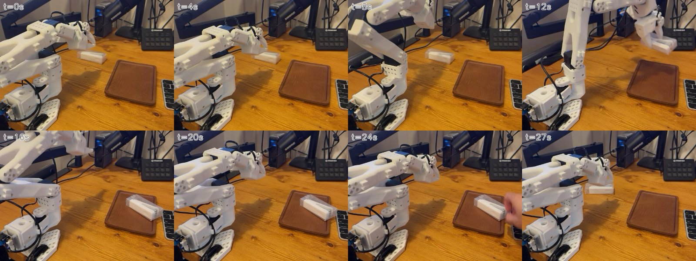

| 時刻 | アームの動き |
|---|---|
| 0〜4 秒 | 休止姿勢からブロックへ向かう |
| 8 秒 | ブロックに手を伸ばしてつかむ |
| **12 秒** | **ブロックを持ち上げている** |
| **16 秒** | **ブロックをトレイの上に置いている** |
| 20 秒 | 腕を戻す |
| 24〜27 秒 | 人がブロックを元の位置に戻すと、またつかみにいく |

**ついに、学習したモデルだけで「ブロックをつかんで、トレイに置く」ことができました。** グリッパーの開き具合の記録も、閉じる → 開く → 閉じる、とつかんで離す流れと一致していました。

30 回版との違いをまとめると、次のとおりです。

| | 30 回版での失敗 | 50 回版での成功 |
|---|---|---|
| デモの回数 | 30 回 | 50 回 |
| 評価時と同じカメラ位置のデモ | 0 回 | 20 回 |
| 評価時の開始姿勢 | 前の回の終わりの姿勢（腕を伸ばしたまま） | 録画時と同じ休止姿勢 |
| カメラのずれ | 2〜4% | 2〜3% |

どれが一番効いたのかは、この 1 回だけでは切り分けられません。それでも、**「評価のときの条件を、録画のときとそろえる」** ことが模倣学習ではとにかく大事だ、というのが今回いちばんの学びです。

---

## 付録：ハマりどころまとめ

| 症状 | 原因 | 対処 |
|---|---|---|
| バックグラウンドで起動すると `EOFError` | キャリブレーション確認の `input()` | 標準入力から Enter を送る |
| 1〜2 分でテレオペが落ち、グリッパーが `Overload error` | カメラマウントの干渉で、キャリブレーションの範囲まで閉じられない | 干渉物を外して再キャリブレーション |
| `Missing motor IDs: 6` | サーボの過負荷保護がかかったまま | フォロワーの電源を入れ直す |
| 動かすと `There is no status packet` や USB の切断 | サーボ間のケーブルの接触不良 | ケーブルを挿し直す（電圧は 12.4V で正常） |
| `latest frame is too old: 510 ms` | Continuity カメラの映像が一瞬止まった | iPhone を給電し、自動ロックをオフにする |
| Colab で `non-default argument 'backbone_cfg'...` | Colab の `transformers` と GR00T のコードの非互換 | ACT なら `transformers` をアンインストール |
| Colab で `Parquet magic bytes not found` | macOS の tar が作る `._*` ファイル | `COPYFILE_DISABLE=1` で固めるか、展開後に削除 |
| 評価でブロックの奥の机をつかみにいく | 俯瞰カメラの位置が収録時からずれた | カメラを固定して録り直す。手首カメラを併用する |
| 評価の起動直後にカメラの読み込みで落ちる | Continuity カメラが開いた直後だけ 16:9 で届く | 起動直前にカメラを一度開いて閉じる |
| `--resume=true` で `requires an explicit 'root' directory` | 追記するときは保存先の明示が必要 | `--dataset.root` を付ける |
| 1GB のファイルがドライブに上がらない | ドライブのアプリが大きいファイルの送信で詰まる | 10MB に分割し、チェックサムを添えて、アプリを再起動する |
| 評価の準備時間中に落ちて、直前の回が消える | `lerobot-record` は準備時間のあとに保存する | 1 回ずつ実行して `--resume=true` で追記する |
