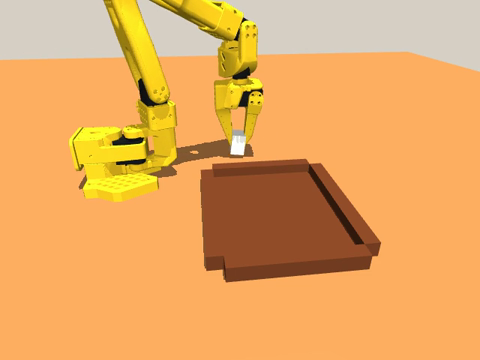
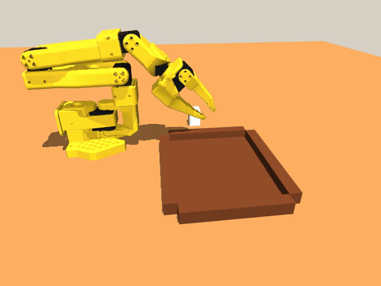
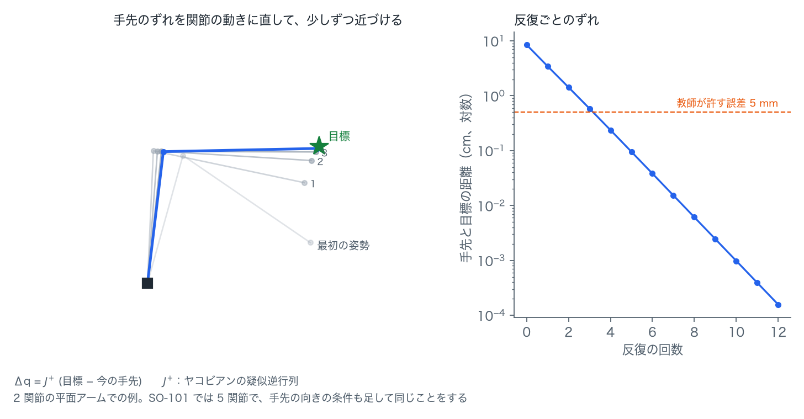
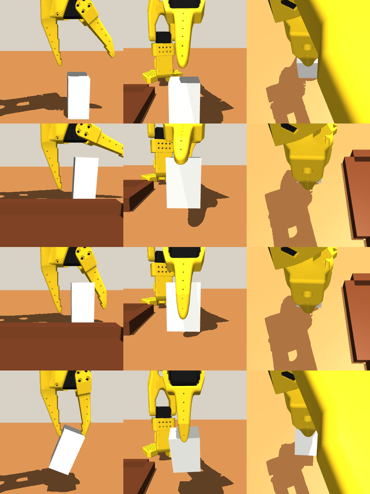
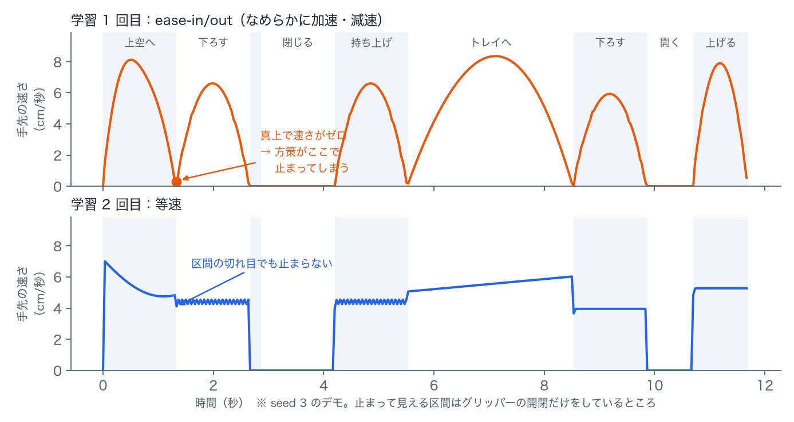
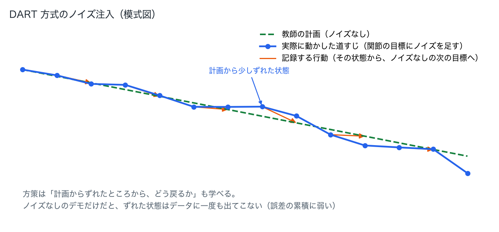

実機の SO-ARM101 で模倣学習（[前回の記事](./so101-imitation-learning-act.md)）をやったあと、MetaWorld で ACT を試してシミュレーションの手応えを掴んだので、今回は **自分のロボット（SO-ARM101）の MuJoCo モデル** でピック＆プレースを学習させます。

ゴールは「実機と同じ流れ（データ収集 → ACT 学習 → 評価）を、人手のテレオペなしに、シミュレーションだけで回す」ことです。

## なぜ MuJoCo か

| | 実機 | MetaWorld | 自前の MuJoCo モデル |
|---|---|---|---|
| ロボット | SO-ARM101 | Sawyer（固定） | SO-ARM101 |
| デモの取り方 | 人がテレオペ（1 回 20〜30 秒 + 失敗のやり直し） | スクリプト | スクリプト |
| 評価 | 人がブロックを置き直す | 自動 | 自動 |
| 失敗したときの原因調査 | カメラ・配線・サーボ…要因が多い | 中身を触りにくい | 全部自分で見られる |

MetaWorld はお手軽ですが、ロボットもタスクも固定です。自前のモデルなら、実機と同じ関節構成・同じカメラ配置で学習させて、将来 sim-to-real（シミュレーションで学習した方策を実機に移す）につなげられます。

## 構成

```
sim/
  so101/so101_new_calib.xml   # ロボット本体の MJCF（TheRobotStudio の SO-101 モデルを元にしたもの）
  so101/pick_place.xml        # 机・トレイ・ブロック・カメラを足したシーン
  so101_env.py                # reset / step / 画像と関節角の観測 / 成功判定
  so101_expert.py             # IK ベースのスクリプトエキスパート（デモの自動生成）
  collect_dataset.py          # エキスパートを走らせて LeRobot データセットに保存
  eval_policy.py              # 学習した方策をシミュレーションで評価
  view_expert.py              # MuJoCo ビューアでエキスパートの動きを眺める
```

- **観測**: 正面カメラ画像（240×320）と 6 関節の角度。実機のときの「俯瞰カメラ + 関節角」と同じ構成です。
- **行動**: 6 関節の目標角度。これも実機と同じです。
- **成功判定**: ブロックの中心がトレイの内側に入り、トレイの床に載っていること。
- **制御周期**: 30 fps。物理は 2 ms 刻みで、1 制御ステップあたり 17 回物理を進めます。

ビューアは `mjpython` で開きます（macOS では `python` ではなく `mjpython` が必要です）。

```bash
.venv/bin/mjpython sim/view_expert.py --loop --speed 0.5
```





## スクリプトエキスパート：テレオペの代わり

実機では人がリーダーアームを動かしてデモを作りましたが、シミュレーションではブロックの位置が正確に分かるので、プログラムでデモを作れます。

1. ブロックの上空 7 cm にグリッパを開いて移動
2. 真下に下ろす（**直線で**下ろす。後述）
3. 閉じる → 持ち上げる → トレイ上空へ → 下ろす → 開く → 上げる

各ウェイポイントは、グリッパ先端のサイトを目標位置へ、かつ「先端が真下を向く」姿勢で到達させる簡単な数値 IK（ヤコビアンの疑似逆行列を 50〜200 回反復）で関節角に変換しています。



### ハマりどころ：0/10 → 20/20 までにやったこと

最初に書いたエキスパートは **10 回中 0 回** しか成功しませんでした。原因は物理モデルの側にありました。

| 症状 | 原因 | 対処 |
|---|---|---|
| ブロックの上端だけをつまんで、運搬中に落とす | 可動ジョーは回転式で、閉じ始めはブロックの上端の角に先に当たる。幅 3 cm のブロックではジョーが平行にならない | ブロックの幅を 2 cm にして、可動ジョーがほぼ平行（開き角 0〜0.1 rad）で当たるようにした |
| 下降中にブロックが 5 mm 押されて傾く | **衝突形状がメッシュの凸包**になる。固定ジョーとモーターハウジングが 1 つのメッシュなので、間の凹みが埋まって斜面になり、それがブロックの上面に当たっていた | 固定ジョーの衝突形状を 3 つの箱（指先・指の根元・ハウジング）に置き換えた |
| 関節空間で補間すると下降経路が数 mm 外側にふくらむ | 関節角の線形補間は、手先の直線運動にならない | 下降・上昇は毎ステップ IK を解いて、手先位置を直線補間 |
| 持ち上げで IK が収束しない | 運搬高さ 9 cm では手首関節が上限（1.66 rad）に当たり、真下向き姿勢を保てない | 運搬高さを 7 cm に下げた |



特に 2 つ目の「凸包」は、MuJoCo でメッシュを衝突に使うときの定番の落とし穴です。MuJoCo はメッシュの衝突判定に凸包を使うので、**凹んだ形のパーツは、凹みが埋まった形で当たります**。可視化はきれいでも当たり判定は違う、というわけです。

これで 20 シード中 20 回成功するようになりました。

## データ収集

```bash
.venv/bin/python sim/collect_dataset.py --episodes 50 --root sim/data/so101_sim_pick_place
```

- 1 エピソード 355 フレーム（約 12 秒）。ブロックの初期位置は毎回ランダム（x: 18〜26 cm、y: 4〜12 cm）。
- 失敗したエピソードは保存しません（今回は失敗なし）。
- データセットは LeRobot v3 形式（parquet + AV1 動画）なので、実機のときと同じ `lerobot-train` にそのまま渡せます。
- 学習用シードは 1000 以降、評価用シードは 0〜19 にして、**評価は未知のブロック位置**で行います。

## 学習 1 回目：ACT、50 エピソード、4,000 ステップ

実機のときと同じ ACT（Action Chunking with Transformers）を、同じ `lerobot-train` で学習させます。今回は Colab ではなく Mac の GPU（MPS）で回しました。1 ステップ約 1.4 秒、4,000 ステップで約 1.5 時間です。

```bash
.venv/bin/lerobot-train --dataset.repo_id=local/so101_sim_pick_place --dataset.root=sim/data/so101_sim_pick_place \
  --policy.type=act --policy.device=mps --policy.chunk_size=20 --policy.n_action_steps=20 \
  --output_dir=outputs/train/so101_sim_act --steps=4000 --batch_size=8 --save_freq=1000 --wandb.enable=false
```

評価は未知のブロック位置（シード 0〜19）で、1 エピソード最大 450 ステップ（15 秒）です。

```bash
.venv/bin/python sim/eval_policy.py --policy outputs/train/so101_sim_act/checkpoints/004000/pretrained_model --episodes 20
```

| チェックポイント | 成功率 |
|---|---|
| 1,000 ステップ | 4/10 |
| 2,000 ステップ | 2/10 |
| 3,000 ステップ | 5/10 |
| 4,000 ステップ | 4/20 |

**20〜50% で頭打ち**でした。失敗の仕方を調べると、方策はブロックの真上（xy 誤差 1〜6 mm）まではちゃんと行きます。カメラ画像からブロックの位置を読む部分はできているわけです。ところが、そこから**降りずに浮いたまま止まって**しまいます。

原因はデモの作り方にありました。エキスパートはウェイポイント間を ease-in/out（なめらかに加減速）で補間していたので、ウェイポイントの瞬間は**速度ゼロ**になります。ブロックの上空で一瞬止まるデモを 50 回見た方策は、「上空で止まっている状態」から「ほとんど動かない」行動を予測し、そのままそこに留まってしまいます。模倣学習でよく知られた「デモの中の停止状態は吸い込み口になる」問題です。



### 対策（学習 2 回目へ）

1. **等速補間にする**。ウェイポイントで止まらないので、吸い込み口がなくなります。
2. **DART 方式のノイズ注入**。収集中は腕の関節目標に小さなノイズ（標準偏差 0.005 rad）を足して実行し、記録する行動はノイズなしの正解にします。方策が「少しずれた状態からの戻り方」を学べます。
3. エピソード数を 50 → 100 に増やします。



## 学習 2 回目：等速のデモ 100 回 + DART

> この節は 2026-10-26 に作業を止めた時点のメモから書いています。評価は画面に出しただけで、ログのファイルは残していません。

その前に、1 回目のモデル（4,000 ステップ）で ACT の temporal ensembling（係数 0.01）も試しましたが、0/20 とかえって悪くなりました。

上の 3 つの対策を入れたデータセット（`sim/data/so101_sim_pick_place_v2`、100 エピソード）で学習し直しました。5,000 ステップの予定を 3,000 ステップで止めています。

| チェックポイント | 成功率 |
|---|---|
| 1,000 ステップ | 0/10 |
| 2,000 ステップ | 4/10 |
| 3,000 ステップ | 0/10 |

数字は良くなっていませんが、失敗の仕方は変わりました。**上空で止まる失敗はなくなり**、ちゃんと降りてグリッパーを閉じます。ただ、ブロックから 1〜2.5 cm ずれた位置で閉じてしまい、空のグリッパーをトレイまで運んでいきます。止まる問題が解けて、今度は位置の精度が足りない、という段階です。

### 次にやること

- 学習を長く回す。手元の MPS は 1 ステップ約 1.4 秒なので、Colab の A100 でバッチを大きくして 2 万ステップ以上
- 手首カメラを足す。俯瞰カメラだけだと、つかむ直前の 1〜2 cm のずれが見えにくい

